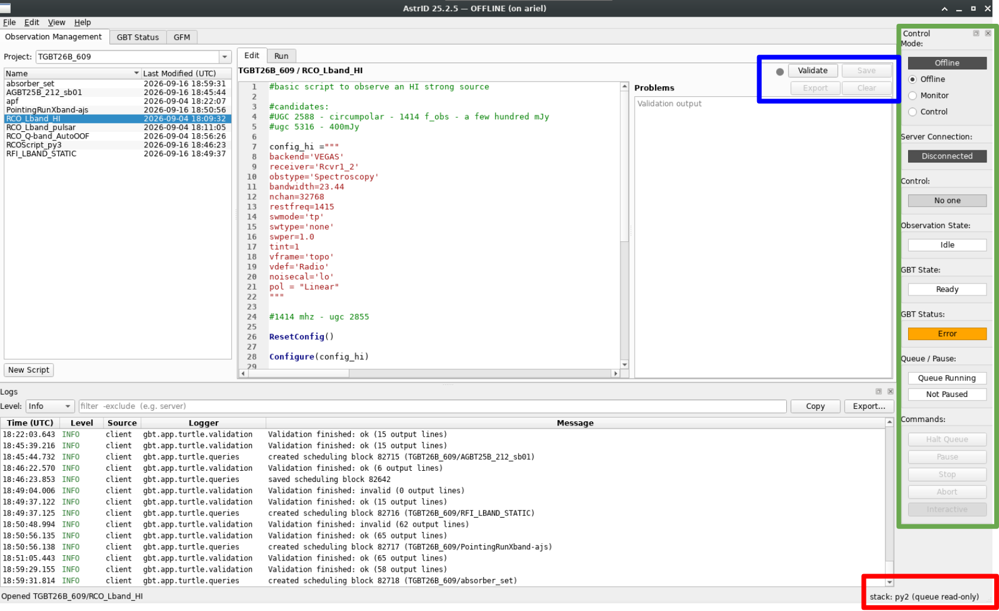
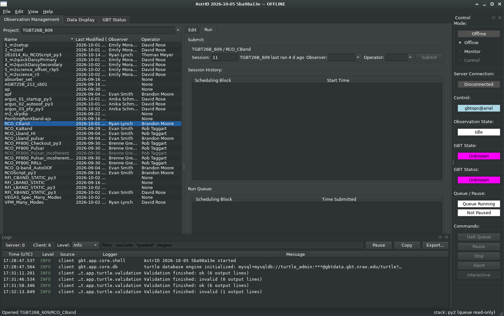
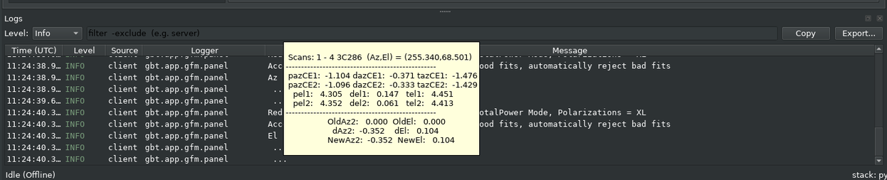

#######################
Python 3 Upgrade Guide
#######################

Why are things changing
***********************

Green Bank Observatory systems have been on Python 2 for a long time. Python 2 has not been officially supported since 2020. So, we have been hard at work upgrading our Python 2 systems to support Python 3, and will be making the switch to a fully Python 3 system for the beginning of GBT Semester 27A.

What is Changing
****************

Operational Procedure
=====================

While the Python 3 system is still undergoing testing, it will coexist with the Python 2 system. However, for telescope safety, only one of these systems will be able to actually command and control the telescope. The operators will have control of this switch, and will ensure you are using the intended Python 2 or 3 system. You will be able to open AstrID offline in both systems at any point, but only one version at a given time will be able to submit scheduling blocks.

Scheduling Blocks
=================

Those of you that have ever gone through a Python 2 -> 3 conversion are aware that there are many changes in the way certain functions and syntax works. So, your scheduling blocks will most likely need to be updated. Here is a list of the most likely changes that will have to happen in your scheduling blocks.

- Print statements
    - Python 3 print statements are an actual function call and require parentheses around the argument. So, ``print "Performing Observation"`` becomes ``print("Perfoming observation")``

- execfile
    - Technically, execfile is not supported in Python 3. However, the exact replacement is quite verbose, so we have written a wrapper function that performs the same purpose under the hood. Thus, you do not need to replace any ``execfile()`` commands. **However, you will still need to update and verify the Python code in the files called by this procedure.**

- Integer and float division
    - Scheduling blocks that use Python 2 division to dynamically determine observing parameters such as number of loops, length of scans, etc. should be carefully inspected to ensure the division is still working correctly. In Python 2, two integers divided with a single division sign will return the floored integer result, so ``9/5 = 1`` under this scheme. Float division can be forced in Python 2 by making one/both of the numbers a float, like so: ``9./5 = 1.8``. In Python 3, float division is always enforced whenever there is a single division sign, so the equation ``9/5`` would now return ``1.8`` by default. You can force integer division by using 2 division signs, like so: ``9//5 = 1``. If you are using this kind of functionality in your scheduling blocks, please ensure you are correctly performing integer or float division wherever you intend to.

- "None" type comparisons
    - In Python 2, one could mathematically compare two variables of differing types to result in a boolean value. In AstrID scheduling blocks, this functionality is most often used to perform checks for the time of day or LST - as in 

    .. code-block:: python

        if GetLST() < 14:
            cal_source = '3C286'
        else:
            cal_source = '3C48'

    If ``GetLST()`` returns "None", which is standard behavior when validating scripts offline, this snippet would run fine in Python 2 without errors, because the ``NoneType`` can be mathematically compared to the integer 14. In Python 3, this would fail, as "None" cannot be meaningfully compared to a number. There is unfortunately no way to automatically detect this until validation, so you will have to be aware of this change if you are using this functionality in your scripts. You can handle this case gracefully by instead conditionally substituting a valid datatype:

    .. code-block:: python

        mylst = GetLST()
        if mylst is None: mylst = 0.0

You can make all of these changes by using the script ``2to3``, which is currently downloaded on the GB filesystem. See :ref:`how-tos/infrastructure/python-3-upgrade-guide:What you need to do` for clear instructions on how to do this. Please note that the "turtle" database that holds these scripts is read/writeable in both systems, so if you are updating your scheduling blocks to Python 3, take care not to overwrite old Python 2 scripts. ``2to3`` allows you to add an suffix to the filename that will help you avoid this. See :ref:`how-tos/infrastructure/python-3-upgrade-guide:What is NOT changing` for items you will not have to worry about.

py3 AstrID
==========

The Astronomer's Integrated Desktop (AstrID) and the data analysis application GBT FITS Monitor (GFM) are written in Python 2, which necessitates a full upgrade of these applications as well. At the time of deployment to the user community, AstrID 3 should provide the same functionality as AstrID 2. You can open the Python 3 version of AstrID simply by typing 

.. code-block:: bash
    
    astrid3

in any terminal window. There are some changes in what's shown on the screen and how users navigate that we would like to draw your attention to. To start, below is a screenshot of the Observation Management tab:

Note the following: 
- The Validate, Save, Export, and Clear buttons have shifted to the top right corner (see blue rectangle). Validate and Save work the same as before, while Export writes the validation output to a text file and "Clear" clears out the text in the validation output. 
- An updated sidebar (see green rectangle). Users can now select which mode to operate AstrID in, see the Turtle server connection status, which username/host is in control of the GBT, and other more familiar status and command widgets. 
- The lower right shows which system (Python 2 or 3) is currently in control of the telescope (see red rectangle).

Other functionality in this window remains relatively the same. You can still select projects from the dropdown or by typing them directly; you can select scripts and edit them; and see the observation log at the bottom of the screen.

One important note to make about the Turtle server is that the Python 3 upgrade allowed for a complete rehaul of the connection systems between AstrID clients, the Turtle server/database, and the GBT Monitor & Control system. In Python 3, there will no longer be any need to restart AstrID after a Turtle or Chalice (grail replacement) restart. Instead, the widget in the sidebar will show "Disconnected" as it does in the screenshot (see the “Server Connection” section in the green rectangle in the screenshot above), then back to "Connected" automatically after the restart is done. This should improve the observing procedure in many cases. Further, the Python 3 system no longer creates a large drag on the Turtle server when there are many AstrID clients being open. Performance should not degrade if there are excessive AstrID clients open and connected.

The Run Tab is below.

You will see that extra information has been added to the Scheduling Block list to help with versioning and logging. The Project field is also auto-filled from the current Project area you have selected, and the Submit button has been moved to the top right of the screen. Otherwise this tab functions the same way as before.

py3 GFM
=======

The GBT FITS Monitor (GFM) is mostly staying the same, but there are a few changes to note. First, it is much easier to change settings for Peak and Focus analysis. By going to the "GFM" dropdown from the top bar, you can open settings for either type of scan, and change as many options as you would like in any tab of the dialog window that pops up before saving, such as heuristics and fitting acceptance criteria. You can also use this dropdown box to send your own corrections to the telescope.

Next, because of unresolved line length issues, the Peak and Focus fit summaries that show up in the log are minimized into ellipses "...". If you want to view the fit results, you can show them  by hovering your mouse over the last ellipsis. These numbers are also printed to the terminal you that you opened AstrID in.

Sparrow Python Environment
==========================

At an expert level, some users (mostly GBO Staff) use software that imports functionality from the same Python environment that everything described above uses. A common use case would be anything that requires the user to run ``source /home/gbt/gbt.bash`` either manually or as the first step in a script, for example. If you use any code with this functionality, there is a good chance it has been updated by GBO Staff; but you should check nonetheless.

What is NOT changing
====================

There are a lot of changes described in this document, but this section lays out what will not change. First of all, the GBT Monitor and Control (M&C) system will not be changing, it is not written in Python. This includes all CLEO windows and Device Manager software, except for a few pyCLEO windows which are already in Python 3 (X-band manager, for example). These will continue to work just as before. The Dynamic Scheduling System (DSS) is also not changing; the GBT will be scheduled just as before and you will be notified via email when you have observations coming up.

As mentioned in :ref:`how-tos/infrastructure/python-3-upgrade-guide:Scheduling Blocks`, the ``execfile`` function will not change; we have written a wrapper to perform the same functionality despite not natively being supported in Python 3.

All GBT Procedures will remain the same as well. These are ``OnOff``, ``Track``, ``AutoPeakFocus``, for example and anything exhaustively listed in :ref:references/observing/sb_commands:Scheduling Block Commands`. If your scheduling block only contains procedures, there are no changes you need to make. Further, Catalog files and configuration strings are still formatted the same exact way.

Other downstream analysis programs including GBTIDL, dysh, GBTgridder, etc. will not change.

How this affects your observations
**********************************

Other than making the effort to update your scheduling blocks and become familiar with AstrID 3, the change from Python 2 to Python 3 should not affect your observations.

What you need to do
*******************

- Take a look at your scheduling blocks for active projects and update them to Python 3, taking care not to overwrite your Python 2 scheduling blocks. To do this using 2to3, export the script to disk, then run:

    .. code-block:: bash

	    $ 2to3 -n -w --add-suffix='3' -x execfile example.py

	This will create a new Python 3 file with the "3" suffix only if there are any changes that need to be made. If there are no changes, no new file will be made. This will also ignore the "execfile" rule. After this, you can import the new script back into your AstrID project area.
- Take a look at the external scripts your scheduling blocks call using ``execfile()`` and ensure they are upgraded and validated.
- Try the new AstrID and familiarize yourself with the UI.
- If you are PI of an operator-run project, we require that you update your scripts, check over the instructions for any changes that may have to be made, and run the first Python 3 session of your project yourself. If there are any changes to be made to instructions, send them along to your project friend for approval.
- If you have any other questions about the Python 3 upgrade, talk to your project friend or send a HelpDesk ticket at https://help.nrao.edu/. 

_

Observations and Troubleshooting
********************************

After you've prepared and validated your scripts, you are ready to observe with Python 3! When you log on to do your observations, simply let the operator know that you will be running things in Python 3. While they set things up for you, one of the steps they do will be to switch the version that controls the telescope. After this is done, you can verify this by seeing the current Python version in the bottom right of the Astrid 3 client (Red box in the :ref:`how-tos/infrastructure/python-3-upgrade-guide:Astrid` section). Once the operator gives you the go-ahead, you can take control of the GBT with your Astrid 3 client and start your observations.

Of course, the GBT is a complex system, and many things may go wrong during your observations. If an issue crops up, you or the operator may or may not see it as a Python 3 issue. If you are certain it is a Python 3 issue and not something else, and you cannot fix it right away, you should fall back to using Python 2 and continue your session normally. If the issue still persists, then the normal troubleshooting process should ensue, where the operator may call in the on-call scientist or someone else with expertise to help. If you or the operator are certain it is NOT a Python 3 issue, then the normal troubleshooting process should start, and after it is fixed, you may continue your session in Python 3.

