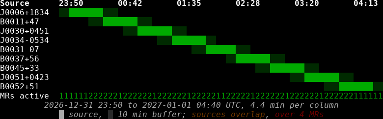
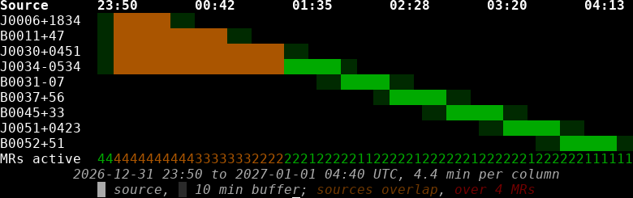
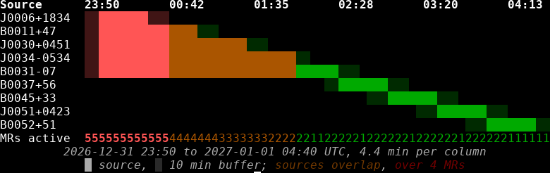
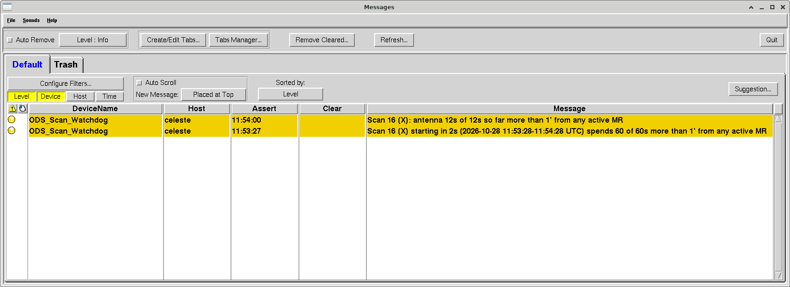

.. _ods-instructions:

Observing with Operational Data Sharing
---------------------------------------

Operational Data Sharing (`ODS
<https://science.nrao.edu/facilities/vla/docs/manuals/obsguide/ods-system>`_)
is system for mitigating the effects of some satellite RFI that can
impact data quality and, in some cases, damage frontend receiver
components.  **ODS is required when observing with certain receivers**
and recommended for some others (see :ref:`receivers` for an
up-to-date list).

When a project requiring ODS mitigation is scheduled in the GBT
Dynamic Scheduling System (DSS) then an automated system will attempt
to generate mitigation requests using one of the methods described
below. 

There are two ways of enabling ODS mitigation.

1. By adding special keywords to Astrid scheduling blocks.
2. By creating specially-formatted Astrid catalogs.

Method 1. should be used for projects that are observing *four or
fewer sources in total*.  Method 1. or 2. can be used for projects
that are observing five or more sources in total, but four or fewer
sources *per observing session*.  Method 2. **must** be used for
projects that are observing *five or more sources per observing
session*.
 
**Regardless of which method is used, observing teams MUST adhere to GBO policies regarding preparing their scripts and catalogs in  advance and certifying that their projects and scripts/catalogs are ready to observe.**

Each method is explained in detail below.

Using ODS with Embedded Scheduling Block Keywords
^^^^^^^^^^^^^^^^^^^^^^^^^^^^^^^^^^^^^^^^^^^^^^^^^

ODS can be enabled by adding *all* the following keywords to an Astrid
scheduling block:

* ``USE_ODS``: Must be ``True`` (boolean)
* ``CATALOG``: Full path to a valid Astrid catalog (string)
* ``SOURCES``: A Python dictionary containing up to four keyword/value
  pairs.  Keywords can be arbitrary but the values must be source
  names specified in the Astrid catalog defined by the ``CATALOG``
  keyword.  These are the locations on the sky that will have ODS
  mitigation.
* ``RECEIVER``: The Astrid receiver name, e.g. "Rcvr_2500" for UWBR
  and "Rcvr1_2" for S-Band (string)

An example of how to use these keywords in a scheduling block is shown below.

.. literalinclude:: scripts/ods.py

Note that ODS mitigation requests will not be generated for any Astrid
scheduling blocks that do *not* contain all of the above keywords.  

Validating that Scripts are ODS-Compliant
"""""""""""""""""""""""""""""""""""""""""

All of the Astrid scheduling blocks currently saved in a project area
can be validated using the following command:

``/home/gbt/sparrow/bin/check_ods_script_new --project <projectID>``

where ``<projectID>`` is the project ID (e.g. AGBT27A_123).  This
command also has options to specify specific scheduling block names,
or to alternatively specify a path to file on disk which contains an
Astrid scheduling block.  Use the ``-h`` option for more details.

This command will report any scripts that are:

* Valid: All ODS keywords and present and the scheduling block can be
  used to generate ODS mitigation requests.
* Invalid: There is a missing or malformed keyword and the scheduling
  block cannot be used to generate ODS mitigation requests.
* Ambiguous: If a script contains valid ODS keywords but ``USE_ODS =
  False`` then the script will issue a warning message.  ``USE_ODS =
  False`` may be used to intentionally skip a script that has been
  prepared in advance but that will not be used for an upcoming
  observing session.

Example output for the script shown above is shown below.  Note that
in this case we provided a path to a file on disk containing the
contents of the script:

.. code-block:: console

   Checking 1 script(s) from local paths:
   
   ============================================================
   Path: ods_test_script
   ============================================================
     [OK] Receiver Rcvr_2500, catalog /home/astro-util/astridcats/pulsars_all_GBT.cat
       pulsar1  B1937+21    J2000 RA  294.910625 deg  Dec  +21.583083 deg
       pulsar2  J1713+0747  J2000 RA  258.456375 deg  Dec   +7.793750 deg
       pulsar3  B0329+54    J2000 RA   53.247333 deg  Dec  +54.578750 deg
       pulsar4  B1929+10    J2000 RA  293.058083 deg  Dec  +10.992333 deg
   
   1 script(s) checked: 1 ok, 0 failed, 0 warned, 0 skipped (no USE_ODS = True).

Next we show example output for a script that intentionally mis-spells
``RECEIVER``, thus generating an error due to a missing ODS keyword:

.. code-block:: console

   Checking 1 script(s) from local paths:
   
   ============================================================
   Path: ods_test_script_error
   ============================================================
     [ERROR]
       Missing required ODS key RECEIVER
   
   1 script(s) checked: 0 ok, 1 failed, 0 warned, 0 skipped (no USE_ODS = True).

Using ODS with an Astrid Catalog
^^^^^^^^^^^^^^^^^^^^^^^^^^^^^^^^

ODS can be enabled by creating an Astrid catalog in
``/home/astro-util/ods/<projectID>/<sessionID>.cat`` where ``<projectID>``
is the complete GBT project ID (e.g. AGBT26A_123) and ``<sessionID>`` is
the DSS session ID (e.g. 01).  The DSS session ID is included in the
GBT scheduling email notices as well as the DSS project page.

The atalog **must** conform to the following rules:

1. It must be a valid Astrid catalog.
2. Positions must be specified in the J2000 coordinate mode.
3. The catalog must contain a ``start`` column with an entry for each
   source.  This is the scan start time for the corresponding source
   in UTC.  It must be an ISOT-format date.
4. The catalog must contain a ``stop`` column with an entry for each
   source.  This is the scan stop time for the corresponding source
   scan in UTC.  It must be an ISOT-format date.
5. No more than four locations can have overlapping observation times.

**Note that ODS mitigation requests will add a buffer of ten minutes to the start and stop time for each location.  This buffer is  included when determining the number of overlapping mitigation request times.**

An example catalog is given below.

.. literalinclude:: scripts/ods.cat
		    
The start and stop times specified in the catalog can then be used to
specify the start and stop times in your observing commands, as seen
below.  

.. literalinclude:: scripts/ods_catalog.py

There are a few things to note:

* In this example we check to see if the scan start time is less than
  five minutes in the future and if it is we start the scan
  immediately by setting ``start = None``.  Because ODS mitigation
  requests are issued with a ten-minute buffer around the start and
  stop times listed in the catalog we will still have ODS mitigation.
* In the example above there are no gaps between the stop-time of one
  location and the start-time of the next.  This obviates the need to
  account for overhead due to slewing from source-to-source,
  configuring, balancing, etc.  However, overhead will reduce the true
  on-source time compared to what would be inferred from the start and
  stop times listed in the catalog.
* In this example we check to see if the scan stop time for each
  source is in the past.  If it is, we skip it.  This ensures that
  sources whose ODS mitigation requests have lapsed will be skipped
  (e.g. if the Astrid script is interrupted part way through an
  observing session).

Validating that a Catalog is ODS-Compliant
""""""""""""""""""""""""""""""""""""""""""

An Astrid catalog can be validated for ODS compliance using the
following command:

``/home/gbt/sparrow/bin/check_ods_catalog <catalogPath>``

where ``<catalogPath>`` is the path to a catalog on disk.  This command
also has options for visualizing the sequence of mitigation requests
and filtering by certain source types.  Use the ``-h`` option for more
details.

Here is the output of this command when it is run on the catalog shown
above.  Note that we used the ``--no-dss`` flag because this is just a
"fake" example catalog which is not tied to a real DSS project.

.. code-block:: console

   AGBT27A_123_01.cat  OK ─────────────────────────────────────────────────────────
     AGBT27A_123/AGBT27A_123_01.cat
     DSS session 'AGBT27A-123 - 01'
     9 sources, 2027-01-01 00:00 to 2027-01-01 04:30 UTC (4h 30m); first starts in 70d 3h 01m
     on source 4h 30m, 100% of the span
     no gaps between sources
     249.1 deg between consecutive sources, largest slew 64.7 deg
     at most 2 MRs active at once; ODS accepts 4
     MRs are not cut to the Scheduled Periods, which were not looked up

Use of the ``--timeline`` options will also create a visual
representation of the mitigation requests sequenced in time:

   A visual representation of catalog-based mitigation requests.  Note
   that the 10 minute buffer applied to each mitigation request is
   shown in light green.  In this case the catalog results in valid
   mitigation requests.

Next we show the output of the same catalog, but edited to
intentionally include four overlapping mitigation requests.  This
produces a warning, but because ODS allows for up to four overlapping
mitigation requests it does not produce an error.

.. code-block:: console

   AGBT27A_123_01.cat  OK ─────────────────────────────────────────────────────────
     AGBT27A_123/AGBT27A_123_01.cat
     DSS session 'AGBT27A-123 - 01'
     warning: sources J0006+1834 and B0011+47 overlap from 2027-01-01 00:00:00.000 to 2027-01-01 00:30:00.000 UTC (30.0 min)
     warning: sources J0006+1834 and J0030+0451 overlap from 2027-01-01 00:00:00.000 to 2027-01-01 00:30:00.000 UTC (30.0 min)
     warning: sources J0006+1834 and J0034-0534 overlap from 2027-01-01 00:00:00.000 to 2027-01-01 00:30:00.000 UTC (30.0 min)
     warning: sources B0011+47 and J0030+0451 overlap from 2027-01-01 00:00:00.000 to 2027-01-01 01:00:00.000 UTC (60.0 min)
     warning: sources B0011+47 and J0034-0534 overlap from 2027-01-01 00:00:00.000 to 2027-01-01 01:00:00.000 UTC (60.0 min)
     warning: sources J0030+0451 and J0034-0534 overlap from 2027-01-01 00:00:00.000 to 2027-01-01 01:30:00.000 UTC (90.0 min)
     9 sources, 2027-01-01 00:00 to 2027-01-01 04:30 UTC (4h 30m); first starts in 69d 10h 09m
     on source 4h 30m, 100% of the span
     no gaps between sources
     249.1 deg between consecutive sources, largest slew 64.7 deg
     at most 4 MRs active at once; ODS accepts 4
     MRs are not cut to the Scheduled Periods, which were not looked up

The visual representation is shown below:

   A visual representation of catalog-based mitigation requests.  In
   this case we intentionally overlap four mitigation requests.  This
   is allowed but it generates a warning and the overlapping
   mitigation requests are shown in orange.
     
In the next example we intentionaly overlap five mitigation requests.
This is invalid and generates an error:

.. code-block:: console

   AGBT27A_123_01.cat  FAIL ───────────────────────────────────────────────────────
     AGBT27A_123/AGBT27A_123_01.cat
     DSS session 'AGBT27A-123 - 01'
     error: 5 MRs overlap at 2026-12-31 23:50:00.000 UTC (sources widened by 10 min each side); ODS accepts at most 4
     warning: sources J0006+1834 and B0011+47 overlap from 2027-01-01 00:00:00.000 to 2027-01-01 00:30:00.000 UTC (30.0 min)
     warning: sources J0006+1834 and J0030+0451 overlap from 2027-01-01 00:00:00.000 to 2027-01-01 00:30:00.000 UTC (30.0 min)
     warning: sources J0006+1834 and J0034-0534 overlap from 2027-01-01 00:00:00.000 to 2027-01-01 00:30:00.000 UTC (30.0 min)
     warning: sources J0006+1834 and B0031-07 overlap from 2027-01-01 00:00:00.000 to 2027-01-01 00:30:00.000 UTC (30.0 min)
     warning: sources B0011+47 and J0030+0451 overlap from 2027-01-01 00:00:00.000 to 2027-01-01 01:00:00.000 UTC (60.0 min)
     warning: sources B0011+47 and J0034-0534 overlap from 2027-01-01 00:00:00.000 to 2027-01-01 01:00:00.000 UTC (60.0 min)
     warning: sources B0011+47 and B0031-07 overlap from 2027-01-01 00:00:00.000 to 2027-01-01 01:00:00.000 UTC (60.0 min)
     warning: sources J0030+0451 and J0034-0534 overlap from 2027-01-01 00:00:00.000 to 2027-01-01 01:30:00.000 UTC (90.0 min)
     warning: sources J0030+0451 and B0031-07 overlap from 2027-01-01 00:00:00.000 to 2027-01-01 01:30:00.000 UTC (90.0 min)
     warning: sources J0034-0534 and B0031-07 overlap from 2027-01-01 00:00:00.000 to 2027-01-01 02:00:00.000 UTC (120.0 min)
     9 sources, 2027-01-01 00:00 to 2027-01-01 04:30 UTC (4h 30m); first starts in 69d 10h 05m
     on source 4h 30m, 100% of the span
     no gaps between sources
     249.1 deg between consecutive sources, largest slew 64.7 deg
     at most 5 MRs active at once; ODS accepts 4
     MRs are not cut to the Scheduled Periods, which were not looked up

The corresponding visualization is shown below:

   A visual representation of catalog-based mitigation requests.  In
   this case we intentionally overlap five mitigation requests.  This
   generates an error and the overlapping invalid mitigation requests
   are shown in red.

Finally, here's an example where the `stop` keyword is missing:

.. code-block:: console
		
   AGBT27A_123_01.cat  FAIL ───────────────────────────────────────────────────────
     AGBT27A_123/AGBT27A_123_01.cat
     DSS session 'AGBT27A-123 - 01'
     error: source J0006+1834: missing stop column
     error: source B0011+47: missing stop column
     error: source J0030+0451: missing stop column
     error: source J0034-0534: missing stop column
     error: source B0031-07: missing stop column
     error: source B0037+56: missing stop column
     error: source B0045+33: missing stop column
     error: source J0051+0423: missing stop column
     error: source B0052+51: missing stop column

The ODS Watchdog
----------------

ODS mitigation requests will be issued when following one of the two
methods described above.  However, in the event that the GBT is
commanded to carry out an scan at a location for which ODS mitigation
is not active then an ODS watchdog program will issue a warning
message via the :ref:`CLEO <cleo>q` Messages application.

The watchdog will issue a warning message when the following
conditions are met:

1. A receiver requiring ODS protection is in focus.  See
   :ref:`receivers` for an up-to-date list of receivers that require
   the use of ODS.
2. The commanded position or positions of the GBT fall outside a
   location with an active mitigation request to within some tolerance
   (see below).

The tolerance for the angular separation between the commanded
location of the GBT and center of the ODS-mitigated region is receiver
dependent.  Current tolerances are shown below.

.. include:: /material/tables/ods_watchdog_tolerance.tab

A screen shot of the CLEO Messages application that includes a
watchdog warning is shown below.  Note that this message was issued
during testing using the X-Band receiver.

   A screen shot of the CLEO Messages application showing a warning
   generated by the ODS watchdog. It shows the scan number, receiver,
   the time-to-target, scan start and stop times, and the amount of
   time the scan will spend in an unmitigated position.  These
   messages were generated during testing and the details of each
   message will differ depending on the scan.

